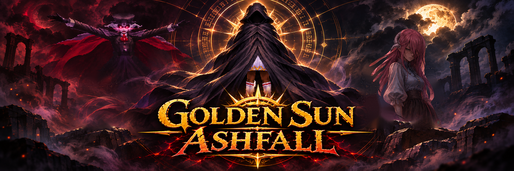

<div align="center">

# GOLDEN SUN: ASHFALL



*The world you remember. A journey that no longer feels the same.*

**A darker, story-driven reimagining of Golden Sun for the Game Boy Advance.**

[](https://github.com/YubelPhoenix/alchemy/releases)
[](#installation)
[](#download)

**[Releases](#download) · [Features](#features) · [Installation](#installation) · [Credits](#credits)**

</div>

---

## Download

> [!IMPORTANT]
> Ashfall is undergoing final gameplay testing. Its first public release has not yet been published.

### [Official releases page →](https://github.com/YubelPhoenix/alchemy/releases)

Published versions will be available here as IPS patch packages with release notes. See the [release notes and readiness checklist](docs/ashfall-release-readiness.md) for the planned first release. Temporary development artifacts may be available through [GitHub Actions](https://github.com/YubelPhoenix/alchemy/actions). They are not a substitute for a tested public release and may expire.

## Return to Weyard

The storm over Vale sets Isaac and his friends on a journey they were never prepared to undertake. The Elemental Stars are stolen, the lighthouses threaten to restore the power of Alchemy, and familiar places begin to feel increasingly uncertain.

As their journey unfolds, new encounters test the bonds between the Adepts. Strangers carry grievances the party cannot understand, and a breach known as the Umbral Rift offers glimpses of a world that should not exist.

Ashfall preserves the foundations of the original adventure while exploring the consequences of its events through a darker, more personal narrative. The familiar world of Golden Sun remains at its heart.

## Features

- **A reimagined campaign:** rewritten dialogue, expanded character interactions and new story events woven into the original adventure.
- **New encounters:** optional superbosses with distinct attack patterns, custom battle artwork and animations.
- **The Umbral Rift:** an unsettling additional area built around familiar places made unfamiliar.
- **Expanded combat:** new abilities, battle mechanics and tactical challenges.
- **Custom presentation:** new sprites, portraits and other visual additions alongside the original game's art style.

## Gameplay screenshots

A spoiler-free gallery of authentic in-game captures is planned for the first release. The banner above is promotional artwork, not a gameplay screenshot.

<!-- Add verified in-game captures here using relative repository image paths. -->

## Installation

Ashfall is intended for the original **English Golden Sun (The Broken Seal)** on Game Boy Advance, not Golden Sun: The Lost Age.

1. Obtain a clean, lawfully sourced dump of your original game cartridge.
2. Verify that its SHA-1 matches the supported base ROM below.
3. Download the IPS patch from the Releases page once a release is available.
4. Apply the patch to a copy of your clean ROM using an IPS-compatible patcher, such as Floating IPS.
5. Open the patched ROM in a compatible GBA emulator or on compatible hardware.

**Supported base ROM SHA-1**

```text
5c4695205413df7db52b9a184815a07783999971
```

Reference: [rom.sha1](rom.sha1).

Keep a backup of your original ROM and save files. A fresh save is recommended for final testing; compatibility across development builds is not guaranteed. The intended release download is a patch, not a complete playable ROM.

## Development status

Ashfall is in its release-candidate phase. Current work focuses on stability, narrative continuity, gameplay testing and release presentation. A successful automated build does not guarantee that every gameplay sequence has been tested.

For technical information, see the [build instructions](INSTALL.md), the [official Ashfall workflow](.github/workflows/build-ashfall.yml), and the original [Alchemy documentation](https://alchemy.pascalpixel.com).

## Credits

**Golden Sun: Ashfall** — YubelPhoenix

**Technical foundation:** [The Alchemy Project](https://github.com/PascalPixel/alchemy), by Pascal Pixel and its contributors. Alchemy reconstructs the original Golden Sun games for video game preservation. Its documentation and upstream development remain separate from Ashfall.

With thanks to the contributors acknowledged by Alchemy:

- Tarpman and Karathan, for compiler and build research.
- Coaltergeist, for [camelot-gcc](https://github.com/Coaltergeist/camelot-gcc).
- [pret](https://github.com/pret), including the [agbcc](https://github.com/pret/agbcc) compiler project.
- [Simon Lindholm](https://github.com/simonlindholm/decomp-permuter), for decomp-permuter.
- [mGBA](https://mgba.io) and the [Golden Sun community](https://www.reddit.com/r/GoldenSun/).

Golden Sun, its original code, characters, artwork and music belong to their respective rights holders. The original game was developed by Camelot Software Planning and published by Nintendo.

Ashfall is an unofficial, non-commercial fan project. It is not affiliated with or endorsed by Nintendo, Camelot or the upstream Alchemy project. No ownership of the original game's intellectual property is claimed.

---

<div align="center">

[Releases](https://github.com/YubelPhoenix/alchemy/releases) · [Development builds](https://github.com/YubelPhoenix/alchemy/actions) · [Release readiness](docs/ashfall-release-readiness.md)

</div>
